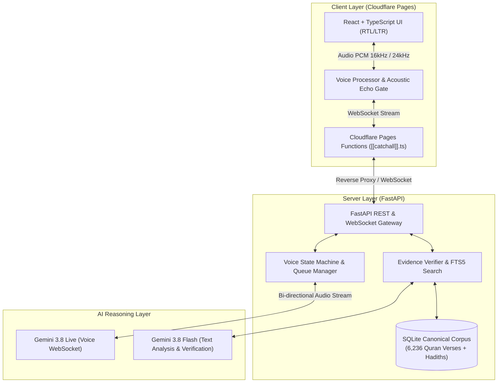

# Daleel-e-Haq (دلیلِ حق)

<p align="center">
  
</p>

<p align="center">
  <strong>Evidence Before Assertion — دلیل سے پہلے کوئی دعویٰ نہیں</strong><br>
  <em>AI-Powered Theological Research, Canonical Quran & Hadith Evidence Verification, and Live Voice Debate Assistant</em>
</p>

<p align="center">
  <a href="https://daleelhaq.pages.dev"></a>
  <a href="https://github.com/islamically85-byte/daleel-e-haq/actions"></a>
  <a href="https://fastapi.tiangolo.com"></a>
  <a href="https://react.dev"></a>
  <a href="https://pages.cloudflare.com"></a>
</p>

---

## 📖 Overview

**Daleel-e-Haq (دلیلِ حق)** is an evidence-first Islamic research platform and conversational debate system designed to eliminate theological hallucinations. Built upon canonical primary texts (Quran and vetted Hadith corpora), Daleel-e-Haq provides instantaneous cross-referencing, multi-lingual textual analysis (Arabic, Urdu, English), and real-time voice-to-voice theological debate using low-latency streaming models.

### Core Principles
- **No Assertion Without Proof**: Every theological assertion must be directly substantiated by canonical texts.
- **Hermeneutic Integrity**: The Arabic text of the Holy Quran is immutable; search indexes use normalized projections while preserving original orthography.
- **Anti-Hallucination Quarantine**: Hadith traditions must resolve to canonical collections with chain verification; fabricated or unverified narrations are quarantined.
- **Natural Voice Debate**: Zero-latency acoustic echo suppression and deterministic state gating prevent self-interruption and double-speak loops during debates.

---

## ✨ Features

### 1. Canonical Corpus Engine
- **Full 6,236 Verses of the Quran**: Arabic Uthmani text with synchronized Fateh Muhammad Jalandhry (Urdu) and Sahih International (English) translations.
- **SQLite FTS5 Full-Text Retrieval**: Diacritic-insensitive Arabic search, morphological normalization, and verse range extraction.
- **Canonical Hadith Verification**: Rigorous cross-referencing against primary collections (Sahih al-Bukhari, Sahih Muslim, Sunan Abi Dawud, Jami` at-Tirmidhi, Sunan an-Nasa'i, Sunan Ibn Majah).

### 2. Live Voice Debate (Gemini 3.8 Live)
- **Bidirectional WebSocket Audio Streaming**: 16kHz PCM capture and 24kHz studio-quality neural voice synthesis.
- **Deterministic State Machine**: Clear, distinct states (`idle`, `listening`, `thinking`, `speaking`, `interrupted`) preventing audio feedback loops.
- **Acoustic Echo Suppression**: Real-time cross-correlation and reference buffering reject speaker output from re-entering the microphone.
- **Dynamic Urdu/English Turn Taking**: Speech endpointer tailored to natural pauses in conversational Urdu and English debate cadence.

### 3. Accessible RTL/LTR Modern UI
- Native **Urdu (Nastaliq/RTL)**, **Arabic (RTL)**, and **English (LTR)** typography.
- Dark & Light theme support with high-contrast theological readability.
- Real-time debate transcription streaming with live claim and source citation badges.
- Voice dictation and neural text-to-speech preview.

---

## 🏛️ System Architecture



---

## 🚀 Quick Start (Local Development)

### Prerequisites
- **Python 3.11+**
- **Node.js 18+** & `npm`
- **Google Gemini API Key** (for live voice and debate models)

### 1. Clone the Repository
```bash
git clone https://github.com/islamically85-byte/daleel-e-haq.git
cd daleel-e-haq
```

### 2. Backend Setup
```bash
# Create and activate virtual environment
python3 -m venv backend/.venv
source backend/.venv/bin/activate

# Install dependencies
pip install -r backend/requirements.txt

# Configure environment
cp .env.example .env
# Edit .env and insert your GEMINI_API_KEY
```

Start the backend server:
```bash
uvicorn app.main:app --app-dir backend --host 127.0.0.1 --port 8000 --reload
```
*The canonical Quran corpus (6,236 verses) is automatically imported into SQLite on first startup.*

### 3. Frontend Setup
```bash
cd frontend
npm install
npm run dev
```
Open **`http://localhost:5173`** in your browser.

---

## 🧪 Testing

### Frontend Suite (Vitest)
Executes unit tests for the deterministic voice state machine, playback queue, and speech endpointer:
```bash
cd frontend
npm test
# Result: 13/13 passing
```

### Backend Suite (Pytest)
Tests evidence retrieval, FTS5 normalization, Quran/Hadith integrity, and adversarial prompt injection defenses:
```bash
./backend/.venv/bin/pytest backend/tests/ --ignore=backend/tests/test_live_gemini_integration.py -v
```

---

## 🌐 Production Deployment

### Frontend (Cloudflare Pages)
The frontend is deployed to Cloudflare Pages with zero-configuration SPA routing:
```bash
cd frontend
npm run build
npx wrangler pages deploy dist --project-name=daleelhaq
```
**Live URL**: `https://daleelhaq.pages.dev`

### Backend (Render / Railway / Docker)

The repository includes pre-built blueprints for instant deployment:
- **Render**: Connect repository and select `render.yaml` blueprint.
- **Railway**: Connect repository; uses `railway.json` + `Procfile`.
- **Docker**: Containerized deployment with Python 3.11 Nixpacks.

#### Connecting Frontend & Backend
Once the backend is live on your cloud host, run:
```bash
cd frontend
npx wrangler pages secret put BACKEND_URL --project-name=daleelhaq
# Enter your backend URL: https://your-backend-service.com
```
Cloudflare Pages Functions will automatically proxy `/api/*` and WebSocket traffic directly to your backend.

---

## 📁 Repository Structure

```
Daleel-e-Haq/
├── backend/
│   ├── app/
│   │   ├── api/             # REST & WebSocket route definitions
│   │   ├── debate/          # Argument analysis & debate orchestration
│   │   ├── db/              # SQLite connection & schema initialization
│   │   ├── evidence/        # Quran/Hadith importers, FTS5 retriever, verifier
│   │   ├── memory/          # Discussion history & session persistence
│   │   ├── providers/       # Gemini GenAI SDK provider abstractions
│   │   ├── config.py        # Environment settings (CORS, hosts, ports)
│   │   └── main.py          # FastAPI application entrypoint & lifespan
│   ├── tests/               # Pytest test suite
│   └── requirements.txt     # Python production dependencies
├── data/
│   └── corpus/              # Canonical Uthmani Arabic, Urdu & English texts
├── frontend/
│   ├── functions/api/       # Cloudflare Pages Functions API proxy
│   ├── src/
│   │   ├── components/      # UI components (Debate, Library, History, Layout)
│   │   ├── voice/           # Voice state machine, audio player & endpointer
│   │   ├── App.tsx          # Root application component
│   │   └── main.tsx         # React entrypoint
│   └── package.json         # Frontend dependencies & scripts
├── Procfile                 # Railway process launcher
├── railway.json             # Railway Nixpacks deployment config
├── render.yaml              # Render Blueprint deployment config
└── runtime.txt              # Python runtime version pin (3.11)
```

---

## 🛡️ Security & Integrity Invariants

1. **Immutable Primary Sources**: Canonical scripture is strictly read-only at runtime.
2. **Quarantine for Unverified Hadith**: Hadith narrations failing chain verification are marked with quarantine flags.
3. **Hermeneutic Guardrails**: The system rejects requests to manufacture verses or fabricate scholarly consensus.
4. **Zero Key Exposure**: API secrets are strictly loaded via server-side environment variables and never exposed to the client bundle.

---

## 📜 License & Credits

Developed with precision by **Zevrako** for authenticated theological discourse and Quranic research.  
Corpus data sourced from audited scholarly Islamic repositories.
